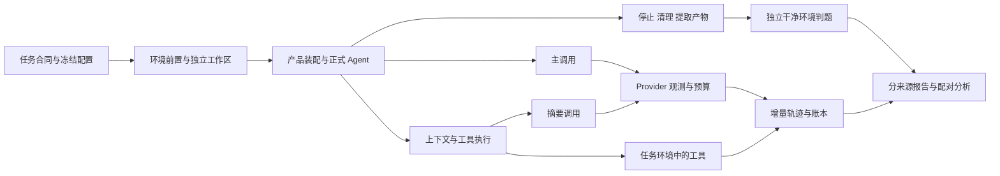

## Context

动机和已确认范围见 [proposal.md](proposal.md)。2026-10-16 当前修订保留 v2 的 147 次终态及全部现存原始工件，先审计恢复和修复证据链，再从原 48 题资产池固定选择 24 题，以新 campaign 规划 216 次。文档轮之后用户已指示继续实施，历史审计、修复和代表链路已完成；真实模型实验尚未启动。下表及随后注明的最初源码观察是 2026-10-09 历史设计依据，不表示当前实现仍缺失对应能力；实际阶段事实以 tasks 和证据为准，不以项目 `docs/` 为事实来源。

源码观察基线为Git commit `287dd45fe7e28702049f9674e0f2d94fbcaf5b45`，项目版本0.1.24；它仅标识本轮审查，未来正式冻结必须重新记录实施后的实际源码树、依赖和策略身份。

| 当前事实 | 源码证据 | 对设计的约束 |
|---|---|---|
| 非交互完成接口复用主 ReAct 循环 | `src/novacode/agent/__init__.py` 的 `run_to_completion()` | 复用现有 Agent，不创建第二套执行引擎 |
| thinking配置与实际请求不完全等价 | `llm/anthropic_provider.py` 在无工具历史时发送thinking及2048预算，输出上限4096；客户端未显式设置重试 | 冻结适配规则并逐请求记录实际参数，处理SDK隐藏尝试 |
| 自动上下文管理无统一关闭策略 | `agent/context_manager.py` 的 `prepare()`；Agent 自动、手动与紧急入口；`session/service.py` 恢复入口 | 开关必须覆盖共享事务及各调用方的状态处理 |
| Layer 2 摘要直接调用 Provider，未消费 usage | `compact/layer2.py` 的 `summarize_once()` | 在 Provider 边界记录费用，不能只累加主 Agent 事件 |
| 工具定义全量导出且 Agent 当前每个 Run 初始取一次 | `tool/__init__.py` 的 `definitions()`；Agent 的 `_tool_definitions()` 与 `run()` | 实现独立曝光状态与每轮定义刷新 |
| 默认注册六个基础工具，CLI 另注册 Memory、Team、Agent 和 MCP | `tool/__init__.py` 的 `new_default_registry()`；`cli.py` 装配 | 基础集合复用现有工具；主集禁用辅助角色，按允许集合过滤其余能力 |
| 工具事件缺少调用关联标识，参数只有预览 | `agent/tool_runner.py` 与 Agent 的 `ToolEvent` | 增补可选关联字段，不能依名称或80字符预览还原并发 |
| 只读工具真实并行执行 | `agent/tool_runner.py` 的 `run()` | 三种实验配置均保留该策略，本 change 不做并行消融 |

只读环境检查发现 WSL 可见 CPU 为 4、内存 5927 MiB、Swap 2048 MiB；Docker 客户端存在，但当前用户访问 socket 被拒绝，daemon 状态未知。官方给出的每实例 4 CPU、16 GB RAM 是资源估算，不能当作所有 Python 题的硬性最低值，也不能据当前容量承诺全部候选可运行。[官方资源与有效性核验说明](https://github.com/microsoft/SWE-bench-Live/blob/main/evaluation/README.md#run-gold-patch)

## Goals / Non-Goals

**Goals:**

- 将真实模型任务执行、业务验收、运行终止和成本账本分开，使失败可定位、实验可重放、报告可复核。
- 用尽量少的生产改动补齐压缩开关、Schema 曝光和观测能力，保留现行模块职责、权限边界及 Provider 单一所有者。
- 将候选、已入库任务、冻结计划和实际运行分别管理，明确“规划完成”与“题库可执行”的区别。

**Non-Goals:**

- 首版不建设分布式调度平台、数据库服务或交互评测看板；账本使用文件，调度和统计优先标准库。
- 主集不使用人工辅助、LLM 判题、子 Agent、长期记忆迁移或跨平台混合成绩；这些能力进入独立专项验收。
- 不延迟 MCP 连接，不用静态删工具充当按需 Schema，不研究只读工具并行的开关。
- 不提交官方榜单、不宣称零污染、全新未接触留出集、生产就绪或普遍优于其他助手；文档修订完成后，实施只推进用户授权的离线审计、修复、验证与新冻结，正式模型调用另待明确确认。

## Decisions

### 1. 自动化驱动正式Agent，外围完成编排与判题

建议以 `python -m novacode.evaluation` 作为独立入口，保持普通 `nova` 的交互职责。入口准备任务环境、构造产品组件、驱动现有 `Agent.run()` 或 `run_to_completion()`、收尾并提取产物；固定多轮专项脚本执行多个 Agent Run，但合计为一次 Evaluation Run。取消和预算需要完整事件及外层任务控制，不能仅依据返回字符串判断成功。

共享装配只提取 CLI 已有的必要初始化与关闭步骤，不重新引入被删除的 SessionController、TurnEngine、runtime/ports 或额外生命周期协调层。核心只接收策略和观测回调，不导入 evaluation。替代方案是全部经 TUI 执行，成本更高且故障混入界面状态；另造简化 Agent 会破坏行为等价性，因此不采用。

### 2. Live保持官方环境，Agent与目标项目解释器分离

Live 的代码、文件操作、搜索和命令必须在对应实例容器内生效。首选在任务容器中以独立 Python 3.12+ 运行环境运行正式 NovaCode，目标项目继续使用原镜像的解释器和依赖；为 Agent 安装运行依赖不能覆盖目标环境，命令路径必须经验收确认。外部进程只负责公开输入、资源监控和结果收集，不把 Docker socket、隐藏判题目录或参考补丁暴露给 Agent。

前置阶段先用一个代表镜像证明独立 Agent 运行环境可部署、六个文件与命令工具看到同一个 `/testbed`、目标测试没有被 Agent 安装步骤改变。若某镜像无法满足，按环境资格规则排除并补选；不能把命令偷偷改到 WSL 主机跑而仍称官方环境结果。本阶段不引入远程工具 RPC 或重写六个工具，容器适配成本和可运行覆盖需实测后报告。

自建题同样使用独立任务目录或容器，隐藏验收由外部干净副本完成。只读辅助工具采用本地固定业务记录，工具实现可以覆盖非基础内置和 MCP 两种注册路径；服务本身的准备时间单列，MCP 两模式都预先建立连接。

### 3. 主集冻结单主Agent及外部状态

任务配置固定工具允许集合、权限规则、通用指令、Hook 配置、Session 初始状态和模型参数；不加载操作者真实用户记忆、历史 Session 或当前项目中的规划文档。主集不注册可执行的 Team、子 Agent、记忆治理任务；或在两模式一致的允许集合中排除它们，不能仅对某实验组隐藏。

无人辅助采用显式冻结授权与正常权限检查；未预授权的 Ask 确定性拒绝并记录，不静默升级权限。应用需要的内部状态仍放在任务根 `.novacode/`，符合现行 Workspace 规范；判题器、参考补丁和其他运行状态由执行环境之外的评测进程拥有。产品配置只输出白名单元数据，不写 API key、认证头或完整用户配置。

### 4. 统一压缩策略置于现有上下文事务

第五阶段已实现布尔配置 `features.context_compression`，缺省为 true。`ContextManager.prepare()` 是统一策略入口：关闭时保留原消息、返回真实无变化及禁用原因；不调用 Layer 1、Layer 2 或摘要裁剪恢复，不产生摘要 Hook 和 compaction 记录。v3 保留该行为，不以证据链修复为由调整压缩阈值或提示。

Agent 自动、紧急、手动、Session 恢复和辅助角色装配必须传递同一策略；调用方依据实际结果展示禁用、保留历史或拒绝不兼容恢复，不能只加一处自动摘要 guard 后让其他入口继续压缩。默认开启时仍由原模块更新锚点和 Hook。工具自身截断、搜索输出预算和模型窗口三组保持一致，关闭压缩并不代表无限工具输出。

### 5. Schema曝光独立于注册和权限

第六阶段已实现布尔配置 `features.progressive_tool_schema`，产品缺省 false，保持全量曝光；实验 `full` 与 `no-compression` 显式设 true。策略适用于所有合格的非基础内置与 MCP 工具。现有基础集合与 `discover_tools` 按原合同保留，并在 eager 组也提供同一个发现入口，保证工具能力集合相同；v3 不根据历史结果调整工具集合。

曝光状态属于一个会话或独立 Evaluation Run，不写到共享 Registry；固定多轮脚本内保留，独立重复间重置。发现按名称精确匹配、规范化词项和描述匹配执行确定排序与有界返回，首版不加 embedding、额外模型调用或语义服务。候选目录仅含允许集合中的名称和简短职责，实际目录输入成本也进入 Token 账本。

发现返回完整 Schema，并将其加入下一轮可见集合；Agent 每轮重新生成当前定义，不再只在 Run 开始取一次。ToolRunner 在保持现有 Hook 与权限检查的同时对未曝光调用给出明确错误；发现不会执行目标工具、扩张允许集合或打开新连接。重复发现幂等；恢复要核验注册清单指纹。摘要后的同一运行仍保留合法曝光状态，但不能把全部工具定义藏入固定提示来绕过实验。

### 6. Provider边界一次记录全部模型成本

在装配端包裹现有 Provider，所有主调用和摘要借用同一被观测实例。薄包装记录请求身份、调用角色、重试关系、单调时间、最终用量和状态，透传原始流和错误类型；实际所有者仍关闭一次，借用方不得自行 close。角色使用显式上下文标记，避免根据提示文本猜测是否摘要。

当前thinking=true只在无工具历史时发送思考参数；三组冻结同一规则和常量，逐请求记录实际参数，不能针对某组单独更改。SDK可能内部自动重试，首版评测配置显式关闭SDK自动重试，保留并记录Agent及摘要的显式恢复；普通产品默认不变，tmux评测传递同一配置。若保留内部重试则必须记录每次HTTP尝试，否则账本不完整。[SDK重试说明](https://github.com/anthropics/anthropic-sdk-python#retries)

现有适配器在协议映射时保留脱敏的原始用量字段及归一化标识。按实测协议确定 input 是否已含缓存、output 是否已含推理 Token，不能把 cache_read 无条件叠加到所有协议。主事件与 Provider 账本不双重相加；请求失败没有 usage 时记未知，预算停止追加调用。金额只在价格或真实账单规则已确认时计算，否则报告 Token，不虚构费用。

工具事件增补调用标识、完整脱敏参数、时间与状态；原 UI 参数预览继续用于显示，不作为审计原文。ToolRunner 起始计数一次，分别保留实际执行、拒绝、发现、错误及重试数量，全部进入相应预算。

### 7. 任务资产与判题资产分开保存

2026-10-15 首配对块发现定位公开格式不完整，用户确认修订后建立新 campaign。定位题统一公开 files 为仓库相对路径字符串数组、symbols 为路径:符号字符串数组、relations 为仓库内函数调用或返回后动态执行的二元边数组；外部参数和库方法不列入这些事实字段。只补充通用格式，不提供任务答案。旧 v1 三次原计划、成本、原评分及误用 TUI 的协议偏差全部保留并停止比较，新 v2 不与旧结果合并。主集统一自动化入口，TUI 验收使用独立开发任务并单列费用。

建议资产根为 `evaluation/`：公开任务合同与初始 fixture 可版本管理，验收资产放在 Agent 不可达的评测存储，模型配置只保留无秘密模板。SWE-bench-Live 数据原件含答案字段，存放在执行环境外并由 curator 生成公开问题包；不要把完整数据行写进 Agent 可读目录。

纯定位在最终回答中输出约定 JSON 段，验证文件、符号与关系；解释文本不纳入开放式语义评分。修复题检查行为与范围；测试题把新增测试复制到正确实现和多个目标缺陷实现，生产代码改动不被允许，收集错误不算检错。最终产物从固定 base commit 提取，包含新增文件和 Agent 已提交的改动；不能只取当前 HEAD diff 而遗漏已提交或未跟踪文件。运行时 `.novacode/` 记录与业务补丁分开。

Live official resolved 与本项目严格成功同时保存：前者按官方测试判定，后者还要求正常终止、范围和清理。超时后补丁碰巧通过可以呈现 resolved=true、strict_success=false，不能混淆两个口径。首次修复后的隐藏验收结果不反馈给同一次运行。

### 8. 文件账本和顺序调度满足首版规模

首版使用 JSON/JSONL 增量账本、补丁与日志文件，明确 schema_version、Evaluation Run ID、请求与工具 ID、内容 SHA-256。原记录不可覆盖，报告可从账本重建；不建设数据库或分布式队列。正式主耗时实验并发度固定为 1，每题每重复构成三配置配对块，通过冻结的种子和均衡配置顺序减小时间与缓存偏差。

24 开发任务继续用于先导与必要开发调试，48 冻结任务保留为父资产池及 v1/v2 历史计划依据。v3 从父池固定选择 24 题，三配置各三次，共 216 行；父 manifest、规则和种子、选择证据、初始基线、修复后代码/运行时、完整预算与分析全部重新冻结，不复用旧 campaign 身份或预算账本。生成计划不启动模型，正式执行需要用户明确确认。

### 9. 配对统计保留独立任务层级

每任务每配置三次独立判分，主成功率比较先取每任务平均。成功率差为主要效果，成本、耗时和工具数量辅助解释；全失败、预算终止和高成本运行也保留。Bootstrap 使用标准库、冻结种子和次数，以任务为单位同时重采样其三配置全部重复，输出95%区间；详细规则见 [evaluation-protocol.md](evaluation-protocol.md)。

Live 与专项分别报告，内部综合指标若展示只按冻结的来源等权宏平均，不称 SWE-bench-Live 全榜成绩。压力子集在运行前定义，实际触发子集只作诊断，不用它筛出更好看的主结果。三配置只能给出“按需 Schema 开启时压缩的贡献”和“压缩开启时按需 Schema 的贡献”，没有两者全关组，不能估计交互。

### 10. 历史审计、恢复及通用证据链修复

先对 147 次终态、账本、归档及全部现存原始工件建立内容指纹，保留原工作区和停止容器；优先尝试离线恢复 FL11/repeat1 三配置、FL14/repeat1 三配置、FL20/repeat1 三配置及 FL20/repeat2 的 full/eager-schema 共 11 次补丁。工具、请求和 Session 记录只在隔离副本受控重建，不向宿主重放历史命令，不用参考修复猜测缺失修改。完整、局部、候选和证据不足四级结论及新判题均另存；测试通过不证明等于历史原产物。全部历史结果均审计，不能仅排查 ungradable；原评分、原成本、35 次未知 usage 与缺失时间不改写。

提取继续用固定 base 表达跟踪源码变化，同时把可信初始镜像中的未跟踪/忽略文件纳入有类型的初始基线；记录普通文件内容、符号链接目标和模式，避免将已有文件伪装成新增或将初始链接误收为业务改动。采用不受 argv 总长度限制且能保留特殊文件名的路径传递，保持临时 Git 索引和可信配置边界。不能只提高 ARG_MAX、过滤所有忽略文件或扩大运行时排除项。

归档成功不只校验现存 tar 成员：还须验证基线、完整业务增量及恢复状态的一致性。缺补丁、提取/归档失败、损坏或无法重建时，持久保留完整工作区或等价快照，不释放失败现场。恢复和派生判题写独占新目录；历史证据不删不覆。将有界、脱敏的异常状态、判题 stderr 和基线指纹另存，防止只留异常类名或因路径含敏感词遮蔽必要文件哈希。

回归覆盖大量路径、特殊文件名、二进制、提交/未跟踪、初始忽略文件/链接的未改与增删改、模式/类型变化，以及提取失败、归档损坏、中断和重入。代表任务使用 FL20、FL07、FL08、FL09 与普通专项的预置正确/错误修改或历史产物，验证提取→归档→恢复→独立应用→外部判题；无需真实模型，结果只证明链路机制。DOCUMENTS_READY 之后已完成上述 10 例正负控制和第 147 次独立重建，取得 EVIDENCE_CHAIN_VALID；新冻结继续绑定独立运行时与逐题初始基线。

### 11. 精简子集与预算的确定性重建

父 manifest、选择方法 compact-v3-selection-v1、抽样种子 20261016、紧凑 JSON 哈希排序、约束求解及替补暂停规则均以协议第 10 节为唯一细则。选择器只读取父任务元数据；12 Live 满足每来源 4/6/2、仓库最多 2 题且至少 8 仓库，12 冻结专项满足 4/6/2、类别 2/2/2/3/3 和既定压力标签。元数据约束可行不等于已选择或已冻结，文档不生成具体入选清单。

类别单次上限保留开发先导校准值，新总预留按所选类别题数×9 后分别加 10% 并向上取整：176,301,111 Token、7,317 Provider、13,187 工具和 66,231 秒。最大单请求 508,821、最大清理宽限 55 秒；已有 25 次迭代规则等隐含参数在新清单显式记录。历史费用只用于容量场景，不作为调参或重校准依据，磁盘阈值需由代表快照实测后冻结。代码里的 48/432/144/72 校验及报告分母须改为有版本的 campaign 规模校验，旧清单仍按旧规则审计，不能全局替换常量。

### 12. 协议快照与启动边界

本轮先保存修订前全部受影响说明及 v2 协议原字节和哈希，旧 manifest、结果与账本不变；当前协议路径更新后旧实时核验失败应阻止执行。历史复核必须通过显式路径映射核对原哈希与原源码/运行时资产，不修改旧 manifest 或忽略差异。后续生成独立 v3 源码、协调器、协议、基线、资产、顺序、预算及统计身份；历史数据不得混入新报告或新计划。

文档修订轮只做规划与静态校验；完成后用户指示继续实施，当前已取得 HISTORY_AUDITED 和 EVIDENCE_CHAIN_VALID，并完成固定元数据抽样。后续顺序仍为新 FROZEN_VALID→用户明确确认→216 次正式运行→报告复核。冻结和首块检查不授权调参；不得恢复 v2 剩余 285 次或重新跑 432 次。脚本化 tmux 已作为无模型产品链机制验收，原有真实 tmux 专项要求仍保留，新增真实调用须明确授权且费用另账。

## Risks / Trade-offs

- 当前 Docker 权限拒绝与内存容量有限 → 第一阶段核验权限、磁盘、运行环境与每题峰值资源；先不调用模型，资格不符的题按来源和难度规则补选，保留排除原因。
- 历史镜像可能不支持独立 Python 3.12+ Agent 环境 → 先验证一个完整实例与目标解释器分离；不改变目标依赖来掩盖适配失败。
- verified 是 LLM 筛选而非人工验证，公开历史题可能被模型见过 → 逐题审查、参考补丁三次核验、记录 issue 日期和数据版本，报告不声称零污染。[官方数据卡](https://huggingface.co/datasets/SWE-bench-Live/SWE-bench-Live)
- 初次只查看 verified 前100行产生选择偏差 → [task-catalog.md](task-catalog.md) 的12条仅为候选内容，正式选择需针对固定版本完整题池按规则分层，不把展示候选冒充最终随机样本。
- Schema 发现调用可能抵消输入节省 → 同时计目录、Schema、发现调用及其间接模型成本，允许实验为负收益。
- 压缩关闭导致运行中超限 → 同初始输入、窗口与预算下保留结果，不偷偷摘要或删历史；初始输入本来非法的题在入库阶段排除。
- 少量机制专项不能支撑强推断 → 报告独立任务数、重复数、触发覆盖和区间，子集明确探索性。
- 同仓库相关性及退化样本限制bootstrap → 区间只解释为所选任务的条件分析，列出仓库/家族覆盖；所有差值相同时标记退化，不能把零宽区间当作效果确定性的证明。
- 远端缓存和服务负载不可完全控制 → 顺序均衡、固定本地资源、保留缓存和请求时间；不宣称彻底消除噪声。
- 验收器可能过宽或过窄 → 用正确实现、缺陷实现、越界修改及错误回答验证，人工抽查；冻结后的合同变更生成新版本并保留旧结果。
- 原 48 题全部已有历史执行结果 → 仅按固定元数据规则选取精简子集，披露已查看，不声称全新留出证据，不按历史效果选题或修改 Agent 策略。
- 独立题目减半及归档保全增加资源占用 → 报告 24 个独立任务和小子集探索性，先测快照峰值并设置磁盘准入，不靠删原证据继续。

## Migration Plan

环境、代码、开发入库、先导及原第十阶段冻结的历史完成事实保留。文档轮与严格静态校验之后，已按 tasks 完成 147 次历史审计、11 次候选恢复、修复及回归、代表独立链路和 24 题抽样；新冻结出口由独立清单与审计确认，用户明确确认后才执行新正式计划。v2 仍为 147/432 的历史部分 campaign，不因 v3 完成而追认 FORMAL_COMPLETE，阶段出口见 [tasks.md](tasks.md)。

生产默认压缩开启、Schema 全量暴露，老配置兼容；新策略需在配置解析、TUI、非交互入口和恢复中统一装配。关闭按需策略即可回到原有工具暴露方式；不能用回滚覆盖已完成实验。若未来明确要求 Git 提交，先递增补丁版本并核验所有版本来源，再按显式文件范围提交。

## Open Questions

2026-10-12 模型身份修订：用户确认沿用现有端点及请求名 `deepseek-v4-flash`。官方当前说明该别名转发到 DeepSeek-V4.1-Flash；先导及后续冻结均区分请求名、响应模型名和文档声明的实际服务版本，不能将别名声称为旧模型或不可变权重版本。端点支持 1M 上下文；先导显式沿用产品既有 200,000 Token 应用窗口（三组相同且小于端点能力），不通过改变窗口制造压缩触发。端点忽略发送的 `thinking.budget_tokens=2048`，未传 thinking 时使用端点默认；因此逐请求记录的是发送条件，实际预算和思考强度按端点文档及响应块另行核验。[官方模型说明](https://api-docs.deepseek.com/quick_start/pricing/)、[Anthropic 兼容规则](https://api-docs.deepseek.com/guides/anthropic_api/)。

11 次补丁已分级为候选恢复，全部 147 次完成可靠性审计；代表链路 10 个正负例验证通过，第 147 次另有可验证的整树重建。24 题按固定元数据规则选出；快照测量、部署与最终冻结完成情况以各自独立收据为准，不用候选通过测试冒充完整历史原产物。模型/端点、三配置、抽样方法与种子、类别单次预算和 216 行规模不变；前置证据缺失时不开始对应步骤或真实模型调用。
